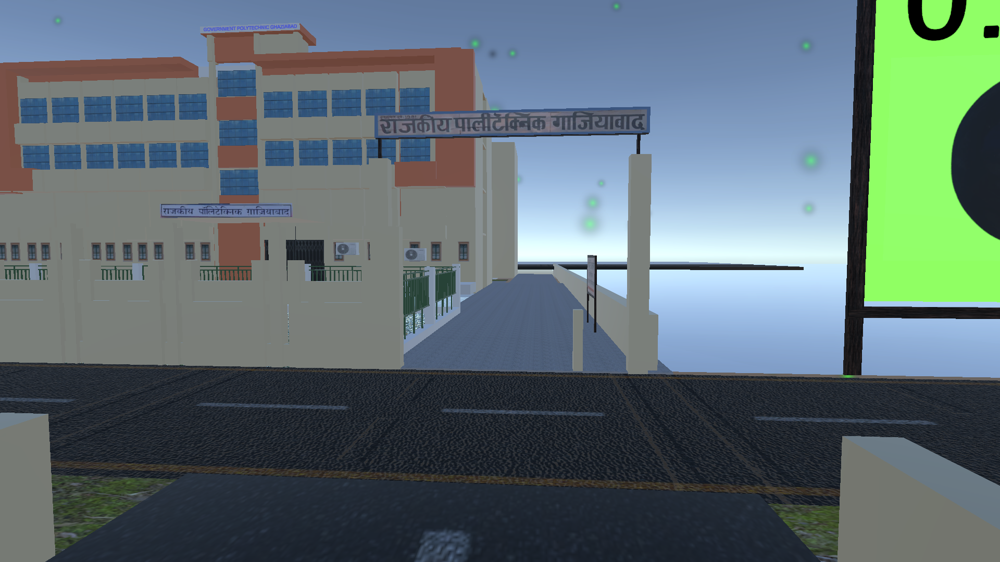
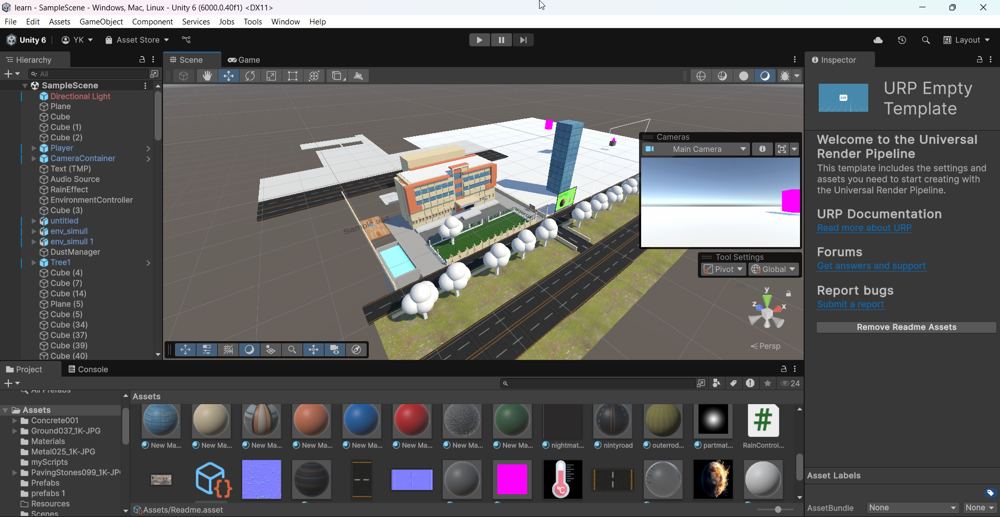
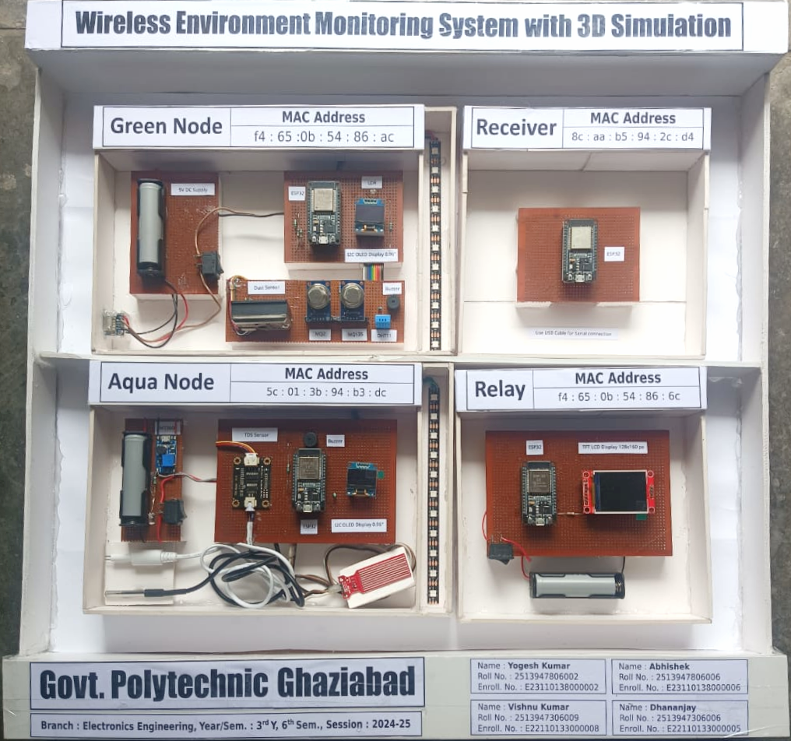

<h1 align="center">Govt. Polytechnic Ghaziabad, UP</h1>

<h2 align="center" style="color:#333;">
  Diploma in 
  Electronics 
  Engineering
</h2>

<h3 align="center">Session : 2024 - 25</h2>

<h2 align="center">Wireless Environment Monitoring System with 3D Simulation</h2>

Thank you for visiting this repository.

✅ 3D Simulation Software is ready!

[Download the ZIP package v1.0 (Windows 64-bit )](https://drive.google.com/file/d/1nP5MdhHIOF6RALNsQvLLOuAH7RFxQ8UK/view?usp=drive_link)
---
<h3 align="center"> #3D Design </h3>

  

<h3 align="center"> Software </h3>

  

<h3 align="center"> Hardware </h3>

  

## 📘 Project Description

This project is a real-time wireless environmental monitoring system built using **ESP32 microcontrollers**, multiple **air and water quality sensors**, and a **Unity 3D simulation** to visualize live data.

It consists of:
- 🟢 **Green Node**: Monitors air quality (MQ2, MQ135, Dust, DHT11, LDR)
- 🔵 **Aqua Node**: Monitors water quality (TDS, Water Level, Temperature Probe)
- 📶 **Relay**: Forwards data from both nodes using ESP-NOW protocol
- 🖥️ **Receiver**: Sends received data to Unity for simulation via Serial

Unity responds with:
- Smoke, colored particles, water tank fill level, day/night effects  
- Audio alerts (`.wav` files) based on pollution or water contamination

---

## 📅 Status

✅ Hardware working  
✅ Data sending and visualization tested  
✅ Software file uploaded

---
## 🏫 Submitted As

> **Major Project (Diploma Final Year 6th semester)**  
> 🏛️ *Department of Electronics Engineering*  
> 📍 *Government Polytechnic Ghaziabad, UP*  
> 🎓 *Academic Year: 2024–2025*
---

## 👨‍💻 Project Developer

**Yogesh Kumar**  💎 {🥈 Silver Medalist : Awarded 2nd Rank in Electronics Engineering }
> Concept, Hardware, Software, Programming & System Integration

---
## 👥 Other Team Members

- **Abhishek**
- **Vishnu Kumar**
- **Dhananjay**
> Project Support

---

> _Feel free to contact us for any queries, collaboration, or feedback._

---

